# BMKs Survival Radio

Custom firmware for the **Quansheng UV-K5** handheld that turns it into a simple, worldwide
emergency and survival receiver: every common short-range channel plan ready to scan, FM broadcast
radio with a background watch, a built-in manual, and a flashlight with strobe and SOS.

Based on [F4HWN](https://github.com/armel/uv-k5-firmware-custom) (fork of
[egzumer](https://github.com/egzumer/uv-k5-firmware-custom) / [DualTachyon](https://github.com/DualTachyon/uv-k5-firmware)).

<p align="center">
  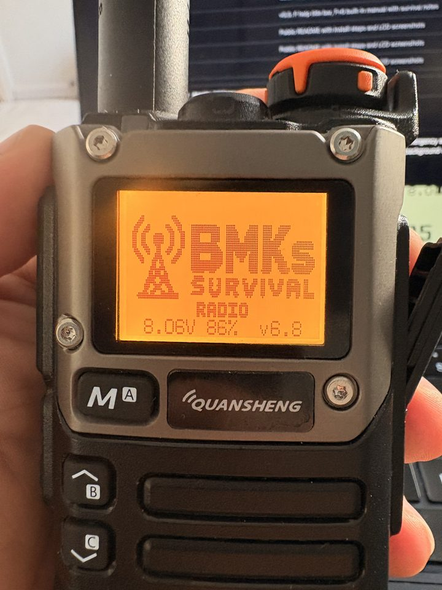
  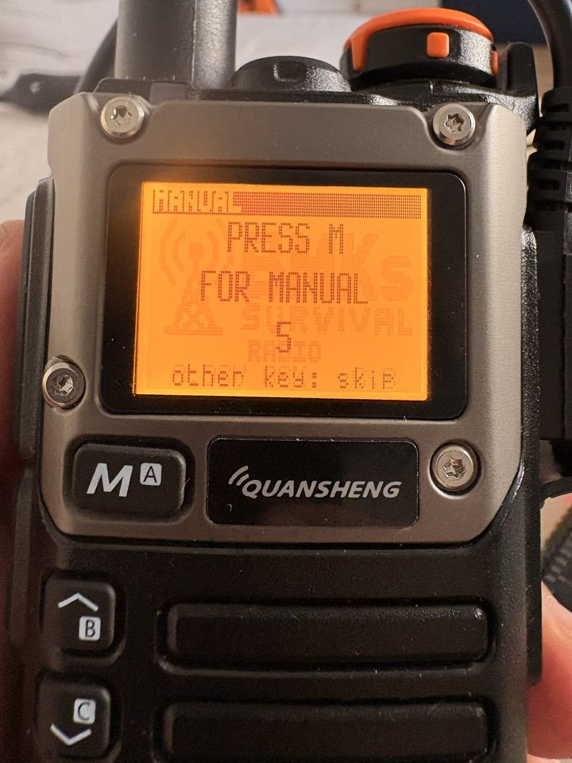
  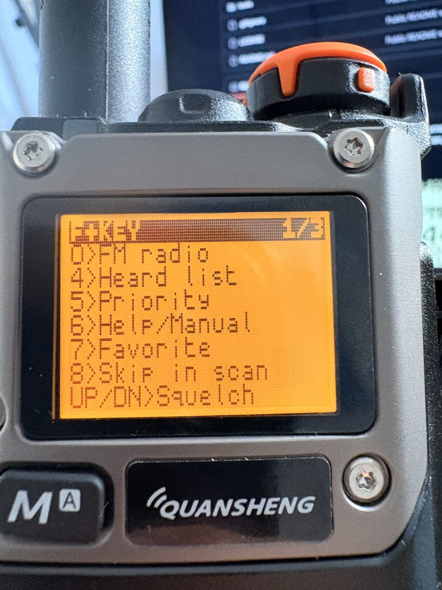
</p>
<p align="center">
  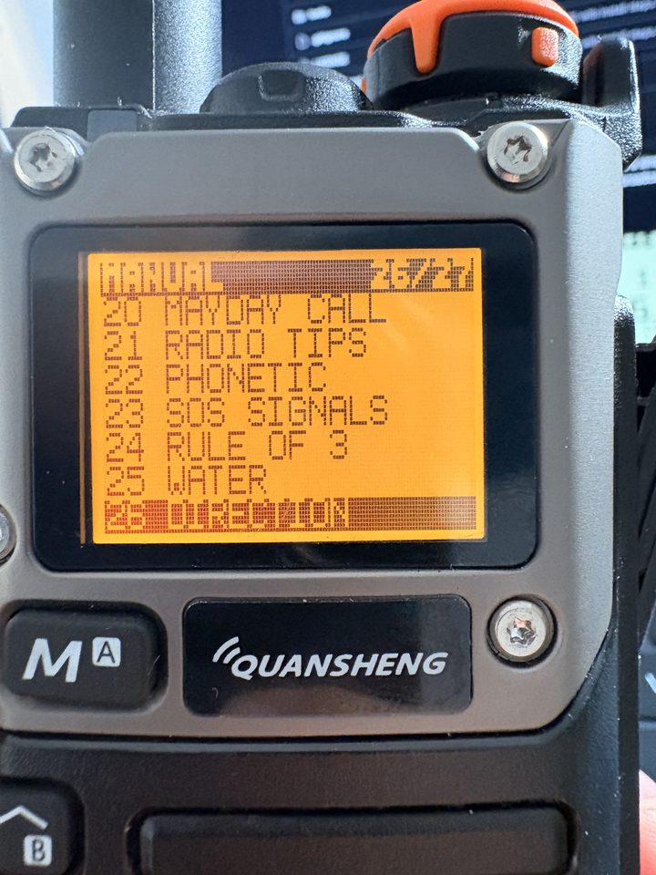
  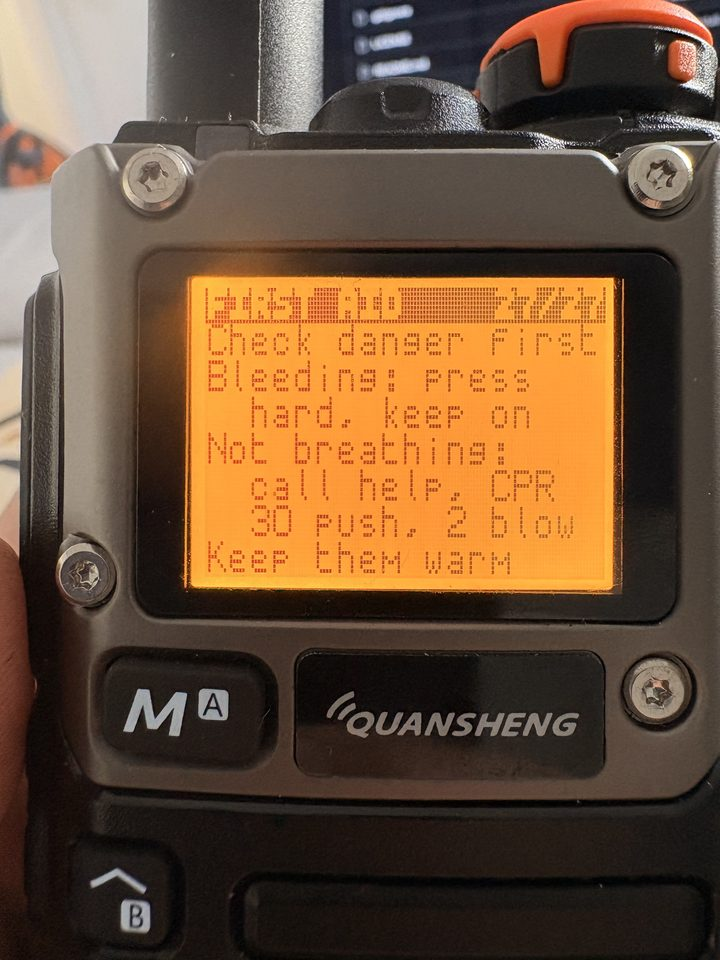
  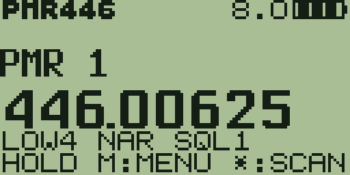
</p>

## What it does

- **Channel groups, ready to use:** PMR446 (16), FRS (22), MARINE (VHF with coast-station duplex and
  NOAA weather), AIR (the whole 118-137 MHz air band, AM), HAM calling channels, CB (40) and your own
  FAV list. `M` steps through them.
- **Fast scan** that stops on a signal. A short RSSI pre-check skips empty steps in ~20 ms.
- **Skip list:** a noisy channel stops the scan? `F+8` and the scan never stops there again.
- **FM broadcast radio** (87.5-108 MHz) that keeps watching your radio group in the background and
  switches over when someone talks.
- **CUSTOM range scan** with your own start, end and step.
- **Favourites, priority channel, recently-heard list** (with age), all on one-key shortcuts.
- **Safe transmit:** sending is allowed only on the bands you enable (PMR and FRS by default). Air band,
  FM broadcast, military air, 406 MHz beacons and marine DSC channel 70 are always blocked.
- **Built-in manual** (`F+6`): 27 topics, from the keys to MAYDAY calls, the phonetic alphabet,
  SOS signals, water, direction finding and first aid.
- **Flashlight:** on, blink, strobe and SOS with the side key.
- **Readable UI:** one meaning per row, big frequency digits, plain-language menu, help on the `F` key.

## Screens

Every image below was captured from the radio's own LCD over the programming cable
(`tools/k5screen.py`), not drawn. The photos above are the same firmware on the radio.

| | |
|:---:|:---:|
| 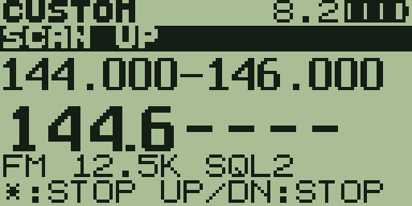<br>Scanning a band (kHz digits dashed while moving) | 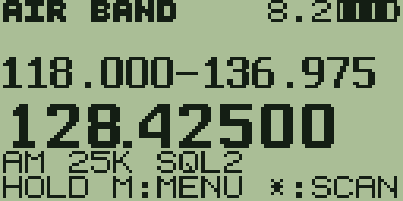<br>AIR band, the whole 118-137 MHz range |
| 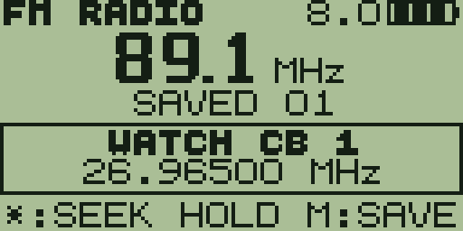<br>FM radio, with the radio group watched below | 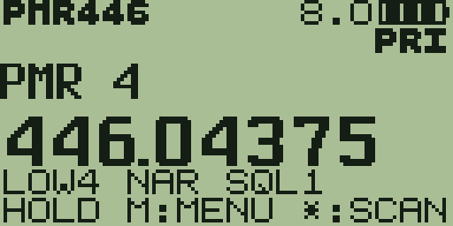<br>Priority channel, marked PRI |
| 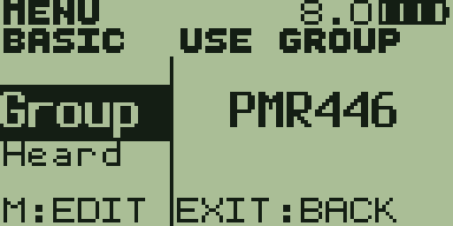<br>Basic menu | 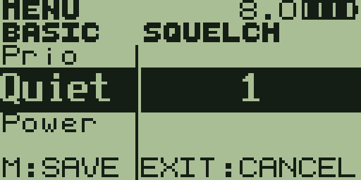<br>Editing a value |
| 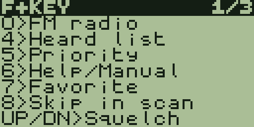<br>`F` tap: the shortcut page | 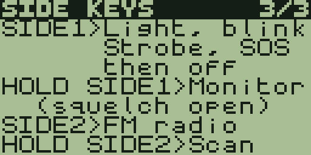<br>Side keys help |
| 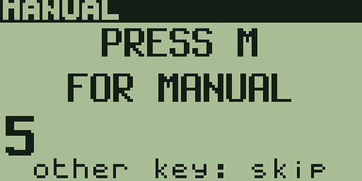<br>After the logo: press M for the manual | 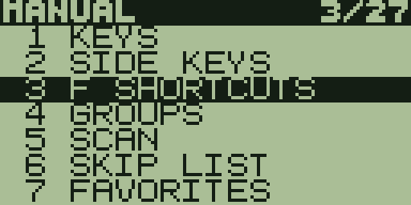<br>Manual index |
| 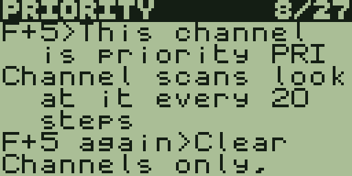<br>A manual topic, a page at a time | 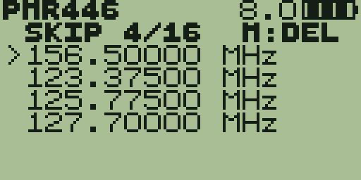<br>Skip list: scans pass these by |

## Keys

| Key | Tap | Hold |
|---|---|---|
| `M` | next group | menu |
| `*` | start / stop scan | |
| `UP` / `DOWN` | channel or step, stops a scan | scan up / down |
| `0`-`9` | type a channel or frequency | |
| `EXIT` | clear typing, back | |
| `F` | shortcut help (then a key) | key lock |
| `SIDE1` | flashlight: on, blink, strobe, SOS, off | monitor (squelch open) |
| `SIDE2` | FM radio on / off | scan |
| `PTT` | talk, only where sending is allowed | |

**F shortcuts:** `F+0` FM radio, `F+4` heard list, `F+5` priority, `F+6` manual, `F+7` favourite,
`F+8` skip in scan, `F+UP/DOWN` squelch, `F+*` scan.

On the FM screen: `UP/DOWN` tune, `*` seek, hold `M` save, `F+*` find all stations, `F+3` saved / tune,
`EXIT` leave FM.

## Compatibility

- **Quansheng UV-K5 with the DP32G030 MCU** (the original UV-K5 and its UV-K5(8) / UV-K6 / UV-5R Plus
  siblings that run F4HWN). Tested on a UV-K5 with stock firmware 2.01.26 and bootloader 2.00.06.
- **Not** for the newer UV-K5 V3 / UV-K1 boards with the PY32F071 MCU: different firmware, do not flash.
- Programming cable: the usual Kenwood-type K-plug USB cable (CH340 or similar).

## Install

Download `bmks.survival.packed.bin` (browser / official updater) or `bmks.survival.bin` (raw, for
`k5flash.py`) from the [latest release](../../releases/latest), or use the copies in [`builds/`](builds/).

1. **Back up your EEPROM first.** The radio's calibration lives in it (0x1E00-0x1FFF) and is unique to
   your unit. For example, with the radio switched on normally:
   ```
   pip install pyserial
   python3 tools/k5link.py --port /dev/ttyUSB0 --dump my_radio_eeprom.bin
   ```
   (`COM3` on Windows, `/dev/cu.usbserial-XXXX` on macOS.)
2. **Bootloader mode:** switch the radio off, hold `PTT`, switch it on, release `PTT`. The screen stays
   blank.
3. **Flash**, either way:
   - **Browser (any OS, Chrome / Edge):** open the [UV tools web flasher](https://egzumer.github.io/uvtools),
     choose *Firmware flasher*, select `bmks.survival.packed.bin`, connect and flash.
   - **Command line:**
     ```
     python3 tools/k5flash.py --port /dev/ttyUSB0 --yes builds/bmks.survival.bin
     ```
4. Switch the radio off and on again **without** `PTT`. On the first start the firmware writes its
   channel tables (your old memories are replaced), then shows the logo and *PRESS M FOR MANUAL*.

To go back, flash any other UV-K5 firmware (for example the stock Quansheng one) the same way.

## Sending: read this

The firmware only lets you transmit FM, and only inside bands you switch on in *Menu > Adv*
(`TxPMR`, `TxFRS`, `TxMAR`, `TxHAM`, `TxCB`, `TxAll`). PMR446 and FRS are on by default; check that
they are licence-free where you are. Marine, amateur and many CB uses need a licence. In a real
emergency where life is at risk, the rules of most countries allow any means of calling for help.

The firmware is provided as is, without warranty. You flash it at your own risk. It is not a
certified safety or distress device: carry a proper one (PLB, marine VHF, phone) when it matters.

## Build from source

The firmware lives in [`firmware/`](firmware/) (F4HWN v4.3 tree plus the survival edition, mostly in
`app/survival.c`, `ui/survival.c` and the `ENABLE_SURVIVAL` sections). Build with Docker:

```
EDITION=survival SURVIVAL_VERSION=v6.9 tools/build-f4hwn.sh "$PWD/firmware"
```

Output: `builds/bmks.survival.bin` and `.packed.bin`. The manual text is
[`design/manual.txt`](design/manual.txt); `python3 tools/manual2c.py` turns it into
`firmware/app/survival_manual.c` and checks every row fits the screen.

| Path | |
|---|---|
| `firmware/` | firmware source (F4HWN based) |
| `tools/build-f4hwn.sh` | Docker build (Alpine, GCC 15) |
| `tools/k5flash.py` | bootloader flasher for raw `.bin` files |
| `tools/k5link.py` | version check and EEPROM dump |
| `tools/k5screen.py` | LCD capture over the cable (F4HWN screenshot protocol) |
| `tools/manual2c.py` | builds the manual from `design/manual.txt` |
| `design/ui_v2/` | the UI design and mockups |
| `docs/DEVLOG_tr.md` | development log, version by version (Turkish) |

## Credits

- [DualTachyon](https://github.com/DualTachyon/uv-k5-firmware) for the open re-implementation,
  [egzumer](https://github.com/egzumer/uv-k5-firmware-custom) and [armel / F4HWN](https://github.com/armel/uv-k5-firmware-custom)
  for the firmware this is built on, and egzumer's [uvtools](https://github.com/egzumer/uvtools) web flasher.
- Boot logo and UI design review made with OpenAI Codex.
- BMKs Survival Radio by Melih Karakelle.

## License

Apache License 2.0, like the firmware it is based on. See [LICENSE](LICENSE).
